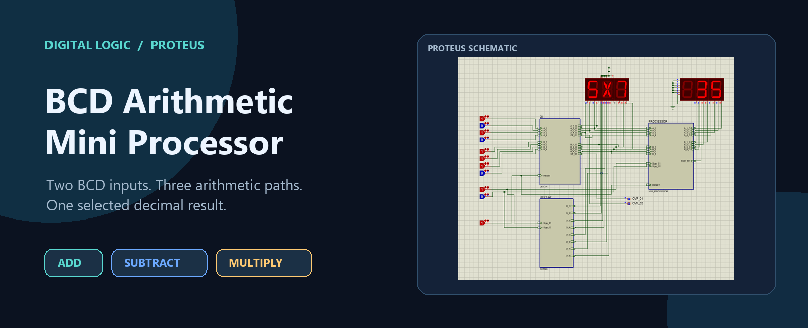
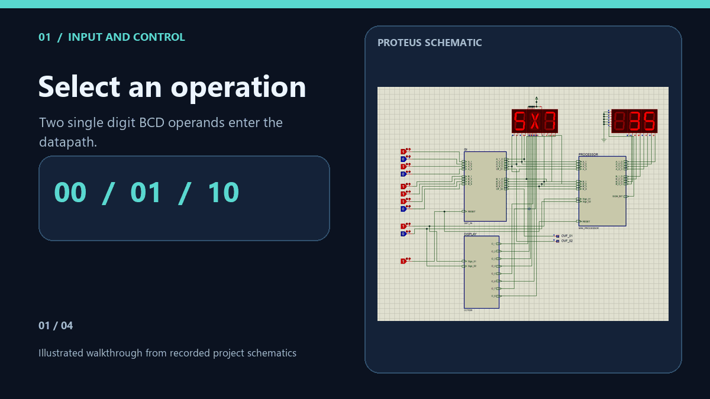
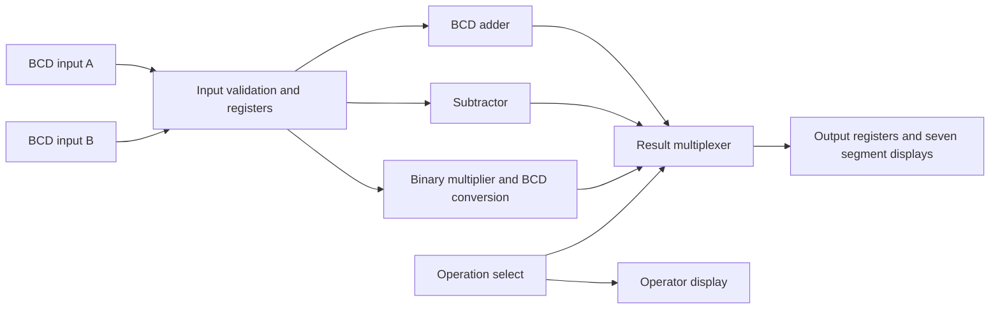
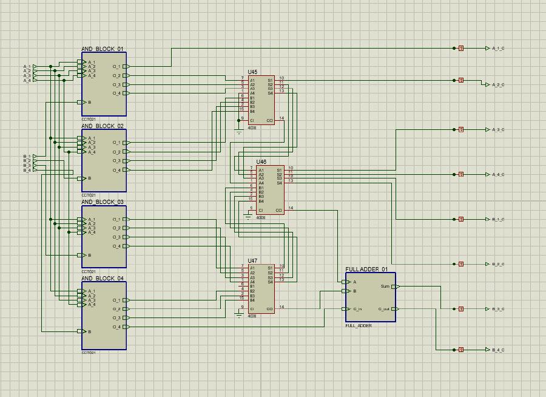
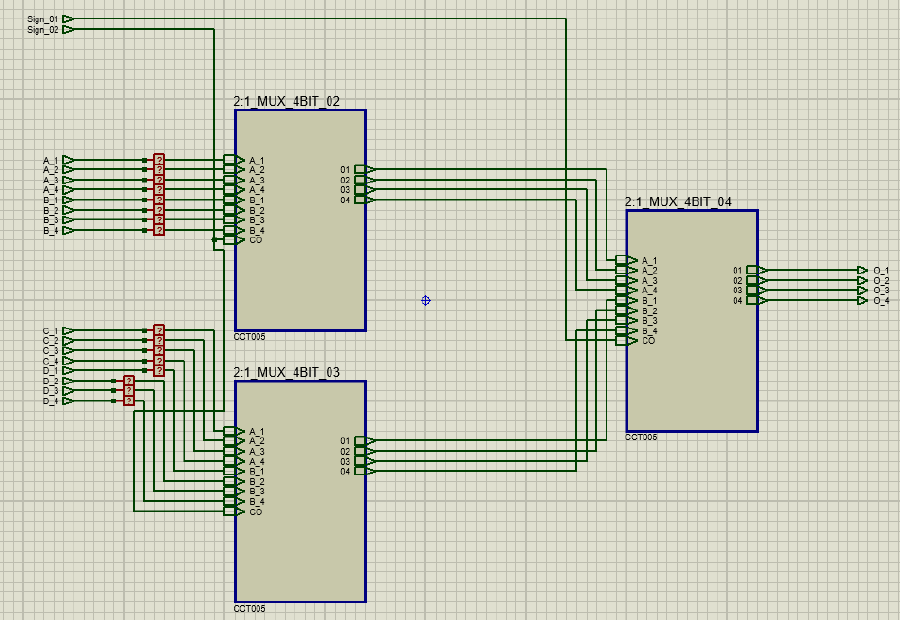

# BCD Arithmetic Mini Processor

A modular digital circuit that accepts two single digit BCD inputs, selects an arithmetic operation, and presents the result on seven segment displays. I designed and simulated the circuit in Proteus using hierarchical schematics, logic gates, multiplexers, and arithmetic ICs.



**Explore:** [Live Proteus demo](#live-proteus-demo) · [Visual walkthrough](#visual-walkthrough) · [Architecture](#how-it-works) · [Recorded results](#recorded-simulation-results) · [Open in Proteus](#open-the-project)

## At a glance

| | |
|---|---|
| **Inputs** | Two 4 bit BCD digits (`0–9`) and a 2 bit operation select |
| **Operations** | Addition, subtraction, multiplication |
| **Output** | Two digit numeric display, operator display, and status signals |
| **Tools** | Proteus schematic capture and simulation |
| **Approach** | Hierarchical modules built from combinational logic and standard ICs |

## Live Proteus demo

[Watch the narrated Proteus simulation (1 min 27 sec)](docs/proteus-live-demo.mp4)

The edited screen recording shows input switches changing, the selected addition, subtraction, and multiplication operations, and the numeric output responding. The narration follows the visible examples and explains the arithmetic paths. A short closing card describes why the reserved division state is not implemented.

## Visual walkthrough



[Watch the short MP4 walkthrough](docs/visual-walkthrough.mp4) · [View the original simulation screenshots](docs/circuit-test-cases.pdf)

The animation is an **illustrated explanation assembled from project schematics and recorded examples**, not a live screen recording of the Proteus simulation. The native project and test-case PDF below provide the reviewable design and simulation evidence.

The [visual source script](scripts/build_visuals.py) rebuilds the hero image and animation with Pillow. Set `FFMPEG_BIN` to an FFmpeg executable to rebuild the MP4 as well.

## Why this project

The aim was to build an arithmetic system from digital logic components and show how a complete datapath can be divided into understandable, reusable blocks. The project connects number representation, arithmetic design, control selection, input checking, and visual output in one simulation.

## How it works



### Input and control

Each operand is entered as a 4 bit value. An input checking circuit identifies values outside the valid BCD range (`1010` to `1111`). The two operation select lines route one arithmetic result to the display through a hierarchy of multiplexers. A separate logic network drives the operator symbol.

| Select bits | Operation |
|:---:|---|
| `00` | Add |
| `01` | Subtract |
| `10` | Multiply |

`11` was reserved for division but was not implemented. Unlike the three supported operations, division can produce a fractional or repeating result (for example, `9 ÷ 2 = 4.5`) and must also handle division by zero. Supporting it would require a divider, a defined precision and rounding policy, and a display format beyond the current two digit integer BCD result. The project therefore completes the three operations that fit its specified datapath and output format, while leaving `11` as a defined extension point.

### Arithmetic blocks

- **Addition:** A 4 bit binary sum is corrected by adding six when needed. An uncorrected sum above nine is not a valid single BCD digit, so this step produces decimal compatible output for the display.
- **Subtraction:** Two's complement turns `A − B` into an addition, allowing the design to use adder ICs. A sign signal distinguishes negative results when `A < B`.
- **Multiplication:** AND gate partial products are combined with adders. The product is binary, so a conversion block maps it to BCD before it reaches the decimal display.
- **Selection:** The operation code drives a result multiplexer so the output stage receives only the chosen arithmetic result. Larger 4 bit and 8 bit selection blocks are assembled from smaller multiplexers because the required wider block was not directly available in the component library used for the design.

| BCD adder | Binary multiplier |
|---|---|
|  |  |



## Design decisions and learning

| Design choice | Reason and effect |
|---|---|
| **Validate each BCD input** | A 4 bit switch can also represent `10–15`, which are not single BCD digits. Checking the inputs makes that invalid range visible instead of treating it as an ordinary operand. |
| **Use BCD correction after binary addition** | Standard binary addition alone can produce a digit above nine. The correction step converts that result into valid BCD digits. |
| **Reuse adders for subtraction** | Two's complement implements subtraction through addition. Sign detection handles the case where the first operand is smaller. |
| **Convert the multiplier output** | Partial product addition naturally yields binary. Conversion is necessary before the two decimal digits can be displayed correctly. |
| **Build a hierarchical MUX** | Combining smaller available components provides the required wider result selection and keeps the control path inspectable. |
| **Use input and output registers** | The design requirements call for stored inputs and outputs, with a `CALCULATE` control signal. This separates entered values from the result being presented during simulation. |

The module boundaries made the arithmetic blocks and control logic easier to build, inspect, and test individually. Together they demonstrate BCD and binary number systems, two's complement, combinational logic, adder based arithmetic, multiplexers, and simulation based debugging.

### Result range and limits

With valid single digit operands, the largest addition is `9 + 9 = 18` and the largest multiplication is `9 × 9 = 81`; both fit the two digit result display. The design report specifies an overflow flag for results above `99`, but that threshold is not reached by these supported operations with valid inputs. This is distinct from the input checks, which identify invalid BCD values above `9`.

## Verification material

### Recorded simulation results

The [design report](docs/design-report.pdf) lists five test cases for each operation. The following representative results are reported there, with simulation screenshots collected in the [circuit test cases](docs/circuit-test-cases.pdf). These are recorded project results, not automated tests run by GitHub.

| Operation | Inputs | Expected decimal result | Reported result | Why it matters |
|---|---:|---:|---:|---|
| Addition | `4 + 5` | `09` | `09` | Single digit sum |
| Addition | `8 + 9` | `17` | `17` | BCD carry and correction |
| Subtraction | `9 − 3` | `06` | `06` | Two's complement path |
| Multiplication | `7 × 8` | `56` | `56` | Binary product to BCD |
| Multiplication | `9 × 9` | `81` | `81` | Largest valid product |

The repository also preserves [all project screenshots](docs/project-screenshots.pdf) and [individual module schematics](docs/module-schematics) for closer inspection.

## Open the project

1. Open [`proteus/IT24103475.pdsprj`](proteus/IT24103475.pdsprj) in a compatible Proteus installation.
2. Inspect the top level schematic and its hierarchical subcircuits.
3. Set the two BCD inputs to values from `0` to `9` and choose `00`, `01`, or `10` with the operation switches.
4. Run the simulation and observe the numeric and operator displays. The supplied PDFs provide reference schematics and recorded test cases.

> **Note:** Proteus is required to open and simulate the native `.pdsprj` project. A GitHub preview of that file is not an interactive circuit simulation.

## Repository contents

```text
.
├── proteus/
│   └── IT24103475.pdsprj
├── docs/
│   ├── design-report.pdf
│   ├── circuit-test-cases.pdf
│   ├── project-screenshots.pdf
│   ├── proteus-live-demo.mp4
│   ├── visual-walkthrough.mp4
│   ├── module-schematics/
│   └── images/
├── scripts/
│   └── build_visuals.py
└── README.md
```

## Scope

This is a simulated educational hardware design for **single digit BCD operands**. It is not a programmable CPU or a physical hardware build. The repository preserves the native Proteus project and supporting documentation so the design can be reviewed beyond screenshots alone.

## Reuse

Shared for portfolio review and learning. No open source license is granted. Contact the author before reusing or modifying the design, schematics, report, or visuals.

Built by [Uvin Kaveesh](https://github.com/Uvin-Kaveesh).

