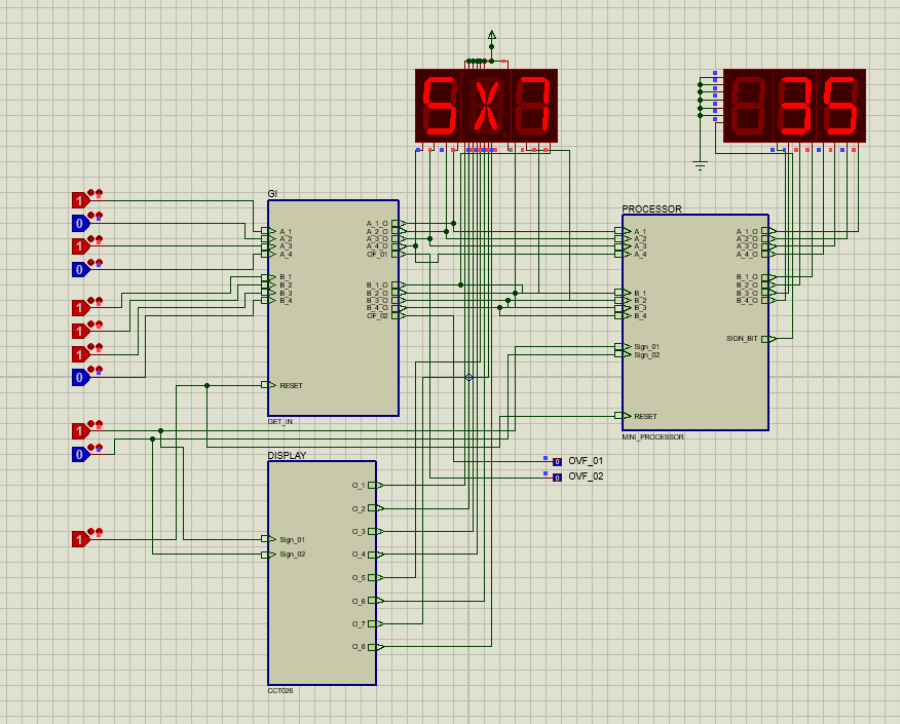
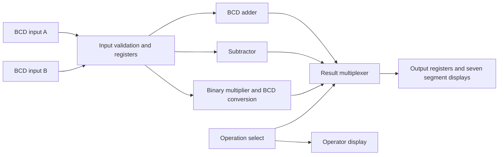
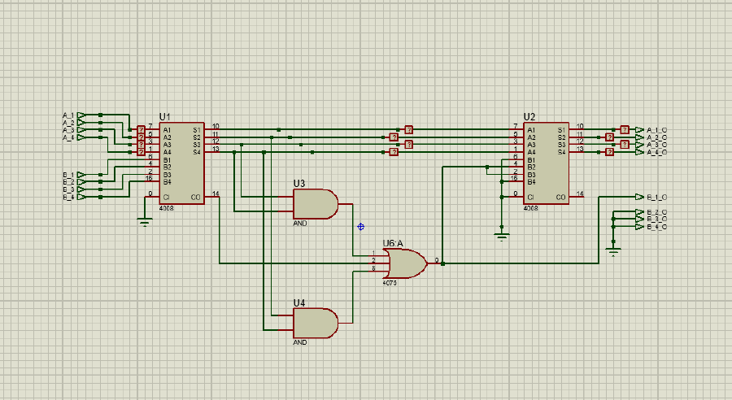

# BCD Arithmetic Mini Processor

A modular digital circuit that accepts two single digit BCD inputs, selects an arithmetic operation, and presents the result on seven segment displays. I designed and simulated the circuit in Proteus using hierarchical schematics, logic gates, multiplexers, and arithmetic ICs.



## At a glance

| | |
|---|---|
| **Inputs** | Two 4 bit BCD digits (`0–9`) and a 2 bit operation select |
| **Operations** | Addition, subtraction, multiplication |
| **Output** | Two digit numeric display, operator display, and status signals |
| **Tools** | Proteus schematic capture and simulation |
| **Approach** | Hierarchical modules built from combinational logic and standard ICs |

## Why this project

The aim was to build an arithmetic system from digital logic components and show how a complete datapath can be divided into understandable, reusable blocks. The project connects number representation, arithmetic design, control selection, input checking, and visual output in one simulation.

## How it works



### Input and control

Each operand is entered as a 4 bit value. An input checking circuit identifies values outside the valid BCD range (`1010` to `1111`). The two operation select lines route one arithmetic result to the display through a hierarchy of multiplexers. A separate logic network drives the operator symbol.

| Select bits | Operation |
|:---:|---|
| `00` | Add |
| `01` | Subtract |
| `10` | Multiply |

The `11` select state is not presented as a supported arithmetic operation in this project.

### Arithmetic blocks

- **Addition:** A 4 bit binary sum is corrected by adding six when needed to produce decimal compatible BCD output.
- **Subtraction:** The circuit uses two's complement arithmetic and a sign signal for negative results.
- **Multiplication:** AND gate partial products are combined with adders. A conversion block maps the binary product to BCD for display.
- **Selection:** Gate level 2:1 multiplexers form larger 4 bit and 8 bit selection blocks.

| BCD adder | Binary multiplier |
|---|---|
|  |  |


## Design decisions and learning

The hierarchical design made each arithmetic and control block easier to inspect in isolation. Building larger multiplexers from smaller ones made the operation selection logic explicit. The multiplier also required a representation change: its binary output had to be converted before a decimal display could show it correctly.

This project demonstrates practical work with BCD and binary number systems, two's complement, combinational logic, adder based arithmetic, multiplexers, modular schematics, and simulation based debugging.

## Verification material

The repository includes the [circuit test cases](docs/circuit-test-cases.pdf), the [design report](docs/design-report.pdf), [all project screenshots](docs/project-screenshots.pdf), and [individual module schematics](docs/module-schematics). These are the original project artifacts supplied with the Proteus design. The screenshots illustrate the circuit structure; the test case PDF is the place to inspect the recorded simulation examples.

## Open the project

1. Open [`proteus/IT24103475.pdsprj`](proteus/IT24103475.pdsprj) in a compatible Proteus installation.
2. Inspect the top level schematic and its hierarchical subcircuits.
3. Set the two BCD inputs to values from `0` to `9` and choose `00`, `01`, or `10` with the operation switches.
4. Run the simulation and observe the numeric and operator displays. The supplied PDFs provide reference schematics and recorded test cases.

> **Note:** Proteus is required to open and simulate the native `.pdsprj` project. A GitHub preview of that file is not an interactive circuit simulation.

## Repository contents

```text
.
├── proteus/
│   └── IT24103475.pdsprj
├── docs/
│   ├── design-report.pdf
│   ├── circuit-test-cases.pdf
│   ├── project-screenshots.pdf
│   ├── module-schematics/
│   └── images/
└── README.md
```

## Scope

This is a simulated educational hardware design for **single digit BCD operands**. It is not a programmable CPU or a physical hardware build. The repository preserves the native Proteus project and supporting documentation so the design can be reviewed beyond screenshots alone.
